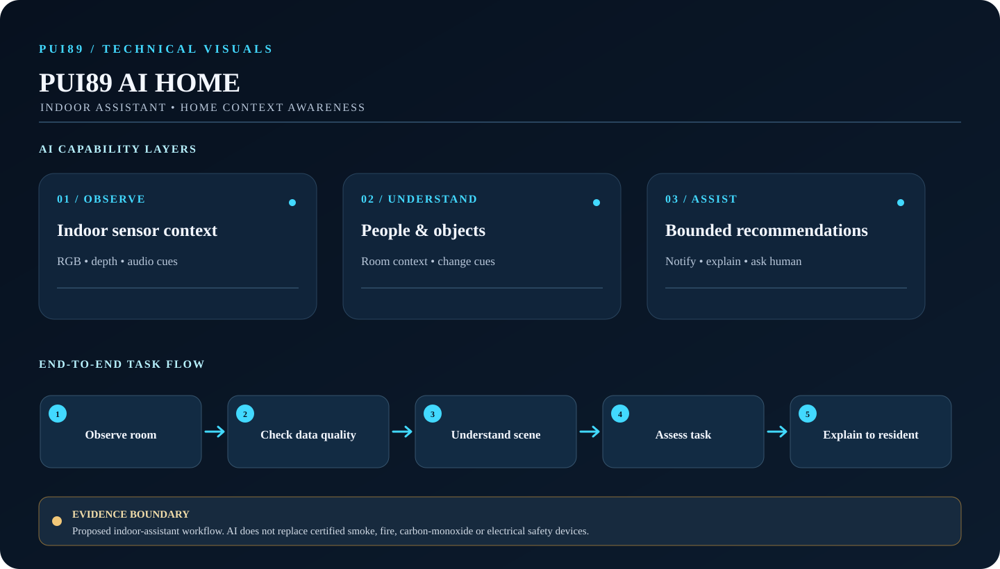

# PUI89 AI HOME — Indoor Home Assistant Robot

[English](README.md) · [ภาษาไทย](README.th.md)

## Product and AI system update — 18 November 2026

**Public product summary (EN):** PUI89 AI HOME is a compact, low-profile, four-wheel indoor assistant concept. It observes owner-authorised home conditions, identifies selected unusual events and sends understandable alerts so residents can verify and respond.

**เทคโนโลยีและประโยชน์ (TH):** หุ่นยนต์ผู้ช่วยภายในบ้านแบบ 4 ล้อ ช่วยสังเกตความเคลื่อนไหว การเข้าออก เสียงเตือน และข้อมูลจากเซนเซอร์ที่ติดตั้ง เช่น ควัน ก๊าซ อุณหภูมิ หรือการรั่วซึมของน้ำ เมื่อพบเหตุที่กำหนดไว้จะส่งสัญญาณให้เจ้าของตรวจสอบ เหมาะสำหรับครอบครัว ผู้สูงอายุ ผู้ดูแล และผู้จัดการอาคาร

**AI technology direction:** computer vision and selected object/motion detection; anomaly detection against configured context; optional sound-event classification; edge AI; IoT sensor integration; event fusion, timestamped history, privacy permissions and phone notifications. Sensor types must be selected for the hazard and installed/calibrated appropriately.

**Physical design target:** four-wheel indoor robot; 25–28 cm wide, 30–33 cm deep, 30–35 cm high; 8 kg target complete mass and 10 kg maximum design ceiling. These remain design targets; payload and detailed mechanical performance require validation.

**Safety boundary:** AI HOME is an additional awareness layer, not a replacement for certified smoke, fire, carbon-monoxide, gas, electrical or water-protection devices. No physical robot, live sensor integration, alert-delivery reliability or validated home-safety performance is claimed. Consequential alerts require human verification and privacy-aware configuration.

**Project website:** [English](https://pui89.github.io/home.html) · [ภาษาไทย](https://pui89.github.io/home-th.html) · [PUI89 portfolio](https://pui89.github.io/)

---

## Product at a glance

**Product direction:** A compact four-wheel indoor assistant for home awareness and everyday support.

**User value:** Help residents notice changes in home conditions and receive understandable, evidence-based prompts for human attention.

**Key capabilities and design priorities:** Indoor scene and condition awareness; home-safety observations; family and emergency support concepts; human-reviewed alerts and privacy-aware operation.

**Evidence maturity:** **Implemented** — early requirements, architecture and software foundations are documented. No physical robot, real sensor integration or validated home-safety performance is established.

**Evidence reviewed:** 17 November 2026. See the [shared PUI89 development record](https://pui89.github.io/) for current evidence, limitations and the next milestone.

**Evidence boundary:** AI recommendations do not replace certified smoke, fire, carbon-monoxide or electrical protection.

**Project links:** [English website](https://pui89.github.io/home.html) · [ภาษาไทย](https://pui89.github.io/home-th.html) · [PUI89 portfolio](https://pui89.github.io/)

---

## Public privacy boundary

This public README is limited to the project overview, approved concept material and evidence that can be shared openly. Do not publish API keys, passwords, private tokens, Wi-Fi or internal network settings, private camera footage, personal or precise location data, detailed security configurations, unreleased engineering specifications, or confidential commercial plans. Keep sensitive material in an appropriately access-controlled private location. If a credential may have been exposed, revoke it; removing it from the latest commit does not remove it from Git history.

## Open-source-first engineering

PUI89 prioritises open-source software, transparent licensing, reproducible workflows and evidence-led collaboration. Model weights, datasets, hosted services and hardware are assessed separately for provenance, licence terms, security, data handling, resource requirements and intended use. Public availability alone does not establish permission for reuse or commercial deployment.

> **PUI89 engineering standard:** [Simple, Safe and Professional](https://github.com/Pui89/Pui89.github.io/blob/main/docs/PUI89_SIMPLE_SAFE_PROFESSIONAL_STANDARD.md) — shared guidance for usability, safety, evidence, privacy and maintainable engineering.

> **PUI89 | Intelligent Systems. Verifiable Decisions. Safer Outcomes.**
> 
> **Project:** PUI89 AI HOME  
> **Focus:** Indoor home-assistant robot concept and home-safety software platform  
> **Development stage:** Initial Stage 2 indoor-perception decision layer added; no completed robot, live camera input or real sensor integration is established.
> 
> **Project website:** [English](https://pui89.github.io/home.html) · [ภาษาไทย](https://pui89.github.io/home-th.html) · [PUI89 portfolio](https://pui89.github.io/)
> 
> **Validation boundary:** AI recommendations do not replace certified smoke, fire, carbon-monoxide or electrical protection; no physical safety function is claimed.

## Project overview

**PUI89 AI HOME** is an indoor, four-wheel assistant concept for home-condition awareness and everyday support. The project is software-first and evidence-led.

- **Stage:** early software foundation and product requirements; no completed robot or real sensor integration is established.
- **Purpose:** help residents notice changes, understand evidence and decide when human attention is needed.
- **Websites:** [English](https://pui89.github.io/home.html) · [ภาษาไทย](https://pui89.github.io/home-th.html) · [PUI89 portfolio](https://pui89.github.io/)
- **Repository:** [Pui89/AI-Home-Safety-Robot](https://github.com/Pui89/AI-Home-Safety-Robot)
- **Related product:** [PUI89 AI NOMAD](https://github.com/Pui89/AI-Mobile-Assistant-Robot) is a separate indoor/outdoor and travel platform.

*Concept illustration built as an embedded SVG. Proposed design only; physical construction and validation remain pending.*

## Compact physical design target — AI HOME

The revised compact form factor is a **proposed design target**, subject to CAD, component selection and physical validation.

| Parameter | Revised target |
|---|---:|
| Width (W) | **25–28 cm** |
| Length / depth (D) | **30–33 cm** |
| Height (H) | **30–35 cm** |
| Complete robot mass | **8 kg target**, including battery and all installed hardware |
| Maximum complete robot mass | **10 kg design ceiling**, including battery and all installed hardware |
| Payload | **TBD**; define after structural, traction, braking and stability calculations |
| Mobility | Four wheels; indoor use |

The external dimensions include the wheels, fixed sensor housing and all permanent external features. Robot mass includes the chassis, enclosure, wheels, motors, battery/BMS, computer, sensors, wiring, connectors, fasteners and guards; payload is accounted for separately.

**Design intent:** a small, low-profile indoor assistant. Keep the battery and other heavy components low and near the centreline. Prioritise a short wheelbase, protected wheels, stable turns, safe stopping, service access and adequate ventilation. Do not add optional displays, audio or sensors unless their function justifies their mass, power and cost.

**Mass-reduction strategy:** use a lightweight but adequately stiff frame; consolidate compute/control electronics where technically appropriate; choose motors from calculated wheel torque and duty cycle rather than oversizing; minimise brackets, fasteners and duplicated housings; use appropriately rated lightweight enclosure materials; and maintain a component-level mass ledger. Do not reduce battery protection, electrical protection, wheel guarding or structural safety to meet the target.

**Engineering checks before design freeze:** verify the complete external envelope in CAD; weigh every selected component and the assembled robot; calculate centre of gravity and tip resistance; validate the 1 kg initial payload and separately assess the 2 kg stretch target, wheel loading, floor transitions, stopping distance, battery containment/charging, thermal behaviour, ventilation, acoustic performance and maintenance access.

**Status: PROPOSED / NOT MEASURED / NOT VALIDATED.** The 8 kg target and 10 kg maximum are design targets, not measured results from a physical prototype. Payload capacity remains TBD and must be established through engineering analysis and testing. No stair climbing, outdoor terrain capability, waterproofing, fire resistance, IP rating or certified safety performance is claimed.

## What it is designed to monitor

Research areas include water leaks and moisture; temperature, humidity and heat; smoke/fire-related signals from appropriate certified devices; non-invasive electrical indicators; visible surface or vibration changes; and environmental changes such as sound and light.

These are monitoring and evidence-research areas—not validated detection, diagnosis or prevention capabilities.

## Proposed operating modes

AI HOME is intended to support three distinct, supervised product modes. These are proposed product requirements and research directions—not implemented, integrated or validated safety functions.

### Mode 1 — Intelligent Living & Environmental Safety

Support owner-supervised awareness of household and building conditions:

- Monitor supported sensor readings and anomalies for temperature, humidity, air quality, water-leak indicators, smoke/gas sensor alerts and equipment conditions where suitable sensors are installed.
- Support building-vibration observation and comparison with a documented baseline; distinguish robot-generated vibration and sensor faults from environmental measurements.
- Assist visual review of visible cracks, moisture marks and surface changes. These are screening observations only, not structural diagnoses or safety certifications.
- Maintain timestamped observations, sensor-health status, uncertainty and reviewable event history.

### Mode 2 — Home Security

Provide privacy-aware, owner-configured security awareness inside the home:

- Detect people and relevant objects in permitted camera views.
- Notify the owner about unexpected visitors or entry events when supported by configured door/window sensors and authorized monitoring zones.
- Monitor owner-designated restricted areas and report possible zone-entry events for human verification.
- Detect selected sound events such as alarms, glass-breaking-like sounds or calls for help, subject to microphone permissions and task-specific validation.
- Identify visible signs of forced entry, such as a damaged window or door, as indications requiring human inspection—not proof of a crime.
- Create concise event records with timestamp, room/zone label, event category, confidence/uncertainty and minimum necessary evidence.
- Support owner-approved notification to designated contacts; emergency calls or external sharing must require explicit configuration and appropriate confirmation.

### Mode 3 — Family & Emergency Care

Support household safety awareness without presenting AI HOME as a medical device or substitute caregiver:

- Research fall-like event detection, prolonged inactivity alerts and calls-for-help detection, with clear uncertainty and human confirmation.
- Support child and pet presence awareness in owner-designated risk areas, subject to privacy and supervised operation.
- Provide emergency event summaries and notify configured caregivers or household contacts when authorized.
- Never diagnose a medical condition or infer a person's identity, health status or intent from appearance alone.

### Shared operating and privacy requirements

- No facial recognition or identity profiling by default. Use temporary, session-limited tracking only when necessary and authorized.
- Do not label a person as an intruder or criminal based solely on appearance, presence or an AI score. Distinguish an observed event from an interpretation.
- Minimise indoor audio/video collection; provide clear owner controls for camera/microphone activation, access permissions, retention and deletion.
- Do not expose private camera footage, floor plans, detailed security configurations, access credentials or resident routines in public documentation.
- Do not autonomously lock or unlock doors, operate barriers, disable alarms, control breakers/valves/appliances, pursue or physically restrain people.
- Certified smoke, fire, carbon-monoxide, gas and electrical protection devices remain primary. AI must not delay evacuation or emergency procedures.
- Consequential alerts and responses require human review. Safe-stop, obstacle avoidance and manual recovery remain independent of security-mode decisions.
- Every capability remains proposed until sensor suitability, model provenance/licensing, privacy controls, false-alarm behaviour and real-world performance are tested and documented.

## Shared AI Core

The project is designed to use versioned `WorldState`, `Observation`, `ActionProposal` and `FailureReport` contracts, with evidence provenance, timestamps, sensor-health checks, uncertainty handling, safety gates and human-reviewed recommendations.

## AI Model & Intelligence profile

**Candidate capability profile:** Object Detection, Image Segmentation and Object Tracking for indoor scene awareness; Sensor Fusion and Anomaly Detection for environmental/sensor-health alerts; bounded VLM/LLM assistance for explanation and communication; Predictive Models only for evidence-supported trends. Certified safety devices remain primary; AI is not an emergency authority.

All nine shared capability families and their definitions, evaluation requirements, provenance/uncertainty rules and safety boundaries are maintained in the [PUI89 Shared AI Core Model Intelligence Framework](https://github.com/Pui89/PUI89-Shared-AI-Core/blob/main/docs/architecture/PUI89_MODEL_INTELLIGENCE_FRAMEWORK_V1.0.md). This product profile is a **candidate engineering allocation**, not evidence of model installation, runtime integration, benchmark results, field validation or certified performance. Select and enable each capability only after product-specific requirements, approved data, compute/energy budgets and verification gates are satisfied.

## Safety and privacy

- Certified smoke, fire, carbon-monoxide and electrical protection devices remain primary.
- Never delay evacuation or emergency procedures for AI analysis.
- Do not control locks, breakers, valves, appliances or certified alarms.
- Do not claim structural, fire, electrical or mould diagnosis without suitable independent validation.
- Stop when localization, obstacle evidence or battery state is uncertain; minimise personal data.

## Development approach

Requirements and hazard analysis → software contracts and synthetic tests → evidence reports → simulation → reviewed sensor integration. No physical safety performance, real-world sensor accuracy or certified function is currently claimed.

## Engineering foundation — Phase 2

The following documents define the proposed engineering baseline. They are requirements and test plans, **not evidence that a robot or safety function has been built or validated**.

- [Product requirements](docs/PRODUCT_REQUIREMENTS.md) — scope, users, measurable requirements and design targets.
- [System architecture](docs/SYSTEM_ARCHITECTURE.md) — evidence flow, shared AI Core contracts and human-review boundary.
- [Safety and cybersecurity requirements](docs/SAFETY_AND_CYBERSECURITY_REQUIREMENTS.md) — safety gates, privacy and security controls.
- [Verification and validation plan](docs/VERIFICATION_AND_VALIDATION_PLAN.md) — software, simulation, bench and supervised test stages.
- [Hardware specification](docs/HARDWARE_SPECIFICATION.md) — component selection criteria and TBD engineering values; research only, no purchasing.
- [Power, battery and Five-Sense engineering baseline](docs/AI_HOME_POWER_AND_FIVE_SENSE_ENGINEERING_BASELINE.md) — proposed power states, battery sizing method, chip-level inventory, six sensor groups, privacy boundaries and verification gates; no parts selected or validated.
- [Preliminary internal layout and historical mass plan (superseded by the current 8 kg target / 10 kg maximum)](docs/AI_HOME_INTERNAL_LAYOUT_AND_MASS_BUDGET.md) — packaging zones, category-level BOM and engineering gates; planning allocations only, not measured weights or selected parts.\n- [Indoor Perception MVP](docs/INDOOR_PERCEPTION_MVP.md) — initial deterministic CPU-first decision layer, conservative safe-hold logic and repeatable unit tests; no vision model or hardware integration is claimed.

### Software-only MVP demonstrator

The first AI HOME MVP work is being developed as a browser-only demonstrator. It uses synthetic temperature and humidity values; it is not connected to physical sensors.

- [MVP product specification](docs/MVP_PRODUCT_SPECIFICATION.md)
- [Sensor integration specification](docs/SENSOR_INTEGRATION_SPECIFICATION.md) — interface and validation requirements; no part selected or purchase approved.
- [Local dashboard specification](docs/DASHBOARD_SPECIFICATION.md)
- [Test and validation plan](docs/TEST_AND_VALIDATION_PLAN.md)
- [Open the local dashboard demo](demo/ai-home-dashboard/index.html) — open this HTML file in a modern browser; no installation is required.
- [Run the browser-based software self-tests](demo/ai-home-dashboard/tests.html) — execute deterministic decision-core checks locally without packages or network access.

The demo has configurable example thresholds and normal, warning, stale, disconnected and invalid scenarios. All readings are simulated, session-only and local to the browser. This work does not establish real sensor accuracy, a built robot, certified alarm capability or physical safety performance.

## Hardware & Materials Sourcing

PUI89 uses a traceable sourcing workflow for materials, mechanical parts, sensors, compute, power and control components. See the [bilingual Hardware & Materials Sourcing guide](https://pui89.github.io/materials.html) for the process covering exact manufacturer/model identification, Thailand and international supplier discovery, country-of-origin evidence, dated pricing and availability, lead times, shipping, compatibility checks and verification gates. Product-specific candidates are added only when supported by evidence; research candidates are not purchases or validated hardware.

### Prototype materials & cost snapshot

**Planning allowance for one research prototype: ฿29,000–90,500.** This is a preliminary estimate from the [PUI89 project-specific BOM](https://pui89.github.io/materials.html#project-boms), not a supplier quotation or verified current market price.

Indoor four-wheel home assistant; 8 kg target design mass and 10 kg maximum design mass.

| Main item | Prototype quantity | Purpose |
|---|---:|---|
| Lightweight chassis/body | 1 set | Frame and enclosure |
| Encoder drive motors + caster wheels | 2 + 2 | Differential drive and support |
| RGB-D camera | 1 shared | Depth perception |
| 2D LiDAR | 1 | Indoor navigation research |
| IMU + bumper switches | 1 + 4 | Motion and contact detection |
| Battery/BMS/protection | 1 set | Protected power |
| Compute/controller | 1 set | Reuse shared compute where suitable |

**Special engineering / purchase gate:** Keep the design indoors and owner-supervised. Verify total mass, wheel guarding, pinch points, emergency stop, battery protection, obstacle sensing and safe docking before any mobile prototype test. The 8 kg and 10 kg figures are design targets, not measured results.

**Shared engineering bench (tracked separately):** approximately ฿16,500–46,000 if the existing development computer is reused. This is a portfolio-level allowance for reusable compute, one RGB-D camera, bench power supply/multimeter, two microcontroller boards and reusable tools/wiring/adapters; it is not added to each project total. Allocate each shared item once, not once per product.

**Cost status:** exact manufacturer/model, manufacturing origin, supplier, stock, lead time and dated prices remain to be verified. Freight, insurance, duty, VAT, brokerage, local delivery, custom fabrication labour and certification are not priced here; calculate Thai landed cost only from dated quotations. Quantities are for one prototype; no purchase or supplier commitment is authorised. Software-first work can continue with available computing and appropriately licensed open-source tools before hardware procurement.

## Perception & Task Intelligence (PTI)

**Role in this product:** support privacy-aware indoor awareness and owner-supervised assistance within a defined home environment. PTI is the shared PUI89 perception-and-task framework; the tasks below are intended capabilities and are not a claim of validated household autonomy.

**Priority perception tasks**
- Check camera and sensor quality, visibility, freshness and availability before interpreting a scene.
- Recognise supported rooms, common objects and people within explicitly defined scope.
- Detect obstacles and changes in the robot's immediate path; estimate distance only with suitable calibrated sensing.
- Interpret mapped indoor regions and navigable areas when a tested map/localisation stack is available.
- Fuse camera observations with approved proximity, contact, battery and environmental sensors while preserving source and uncertainty.
- Report unknown or conflicting conditions, request owner assistance and enter a safe hold when perception or localisation is unreliable.

**Task flow:** OBSERVE → PERCEIVE → ASSESS → DECIDE → RESPOND → LEARN FROM EVIDENCE. Outputs are owner-facing status, alerts and bounded assistance suggestions; they do not establish medical monitoring or unrestricted home autonomy.

**First evidence gate:** recorded indoor scenes and synthetic obstacle cases, followed by supervised tests in a controlled area. Measure obstacle misses, false alarms, localisation loss, safe-stop behaviour, privacy handling and resource use.

**Not established:** reliable household autonomy, medical/fall monitoring, safe operation around children or pets, or validated physical mobility. See the [shared PTI specification](https://github.com/Pui89/PUI89-Shared-AI-Core/blob/main/docs/perception/PUI89_PERCEPTION_TASK_INTELLIGENCE_V1.0.md) (maintainer repository access required).

## Six Core Intelligence Groups — Product Allocation

PUI89 uses six shared intelligence groups across its six active products. This product allocation is a target architecture and capability map; it does not claim that every model, sensor, integration or physical function is implemented or validated.

- Vision Intelligence — image/video understanding, detection, classification, segmentation, tracking, depth and spatial cues.
- Audio Intelligence — speech recognition, sound/event perception, speaker diarisation where justified, audio-visual association, acoustic diagnostics and speech response.
- Multimodal Intelligence — context-aware fusion of vision, audio, text, video and authorised sensor/time-series data with provenance and uncertainty.
- Robotics Intelligence — robot/environment understanding, localisation, navigation, motion planning and manipulation where the product has suitable hardware.
- Action & Reaction Intelligence — task planning, bounded proposals, event response, prediction, recovery and escalation.
- Safety & Control Intelligence — independent permissions, operating limits, verification, human approval, fault handling, safe hold and emergency-stop boundaries.

### PUI89 AI HOME capability allocation

- **Vision:** Indoor people, pets, objects, obstacles, rooms, pose and depth cues.
- **Audio:** Voice commands, speech, doorbell, alarms and household sound events.
- **Multimodal:** RGB-D, audio, IMU, proximity and approved home-context fusion.
- **Robotics:** Indoor navigation, docking and owner-approved assistance tasks.
- **Action & Reaction:** Obstacle/pet/door-alarm/localisation-loss and low-battery responses.
- **Safety & Control:** Owner permissions, privacy-first processing, safe stop and manual override.

**Integration rule:** each product uses only the modules justified by its mission, data rights, hardware, compute budget and validation evidence. Model outputs remain observations or bounded proposals. Safety policy is product-specific and independent of model confidence. Unknown, stale, conflicting or out-of-scope inputs must be surfaced rather than guessed.

**Evidence status:** proposed capability allocation unless a separate implementation record, reproducible test or domain-specific validation explicitly says otherwise. Audio models, speaker diarisation, sound classifiers, VLM/VLA policies and robotics stacks require separate provenance, licence, compute, privacy and suitability review before adoption. No automatic model download or installation is authorised.

### Six-intelligence concept visual

*Concept diagram only: it illustrates intended software intelligence domains, not a built product, installed model stack, integrated sensor suite or validated capability.*

## Development stage

**Current stage:** Early software foundation & requirements  
**ขั้นการพัฒนา:** พื้นฐานซอฟต์แวร์และข้อกำหนดระยะแรก

**Evidence:** Product requirements, architecture, software contracts and early adapter/test foundations are documented.

**Limitations:** No built robot, real sensor integration, certified alarm, or validated home-safety performance is established.

**Next milestone:** Complete a software-only home-safety demonstrator using mock sensor inputs and explicit failure states.

## Website QR codes

| English | ภาษาไทย |
|---|---|
|  |  |
| [Open English page](https://pui89.github.io/home.html) | [เปิดเว็บไซต์ภาษาไทย](https://pui89.github.io/home-th.html) |

## Hugging Face vision models — opt-in local integration

This repository now includes real Hugging Face checkpoint adapters in [`pui89_models/hf_vision.py`](pui89_models/hf_vision.py), with project-specific usage boundaries in [`docs/HUGGING_FACE_MODEL_INTEGRATION.md`](docs/HUGGING_FACE_MODEL_INTEGRATION.md).

- **OWLv2:** `google/owlv2-base-patch16-ensemble` for text-conditioned object proposals.
- **Intel DPT-Hybrid:** `Intel/dpt-hybrid-midas` for relative scene depth where appropriate; not calibrated distance or physical depth.
- **local-first default:** no packages or model weights are installed/downloaded automatically; CPU-only inference, local cache only by default, no hosted inference API or cloud GPU.
- **Evidence status:** adapter code is added; model inference and project-specific accuracy are NOT YET TESTED. Outputs remain uncertain observations for human review, never actuator commands.

## Licence — Apache-2.0 for selected source code only

The Apache License, Version 2.0 applies **only** to the two source-code files listed in [`LICENSE-SCOPE.md`](LICENSE-SCOPE.md) and marked `SPDX-License-Identifier: Apache-2.0`:

- `pui89_models/hf_vision.py`
- `tests/test_hf_vision_adapter.py`

**Not licensed under Apache-2.0:** the PUI89 name, logos, trademarks, brand identity, AI Home Assistant Robot product identity, robot appearance and industrial/product designs, CAD or mechanical drawings, concept images/artwork, website, this README, other documentation, repository configuration, and all unlisted files. Those materials remain reserved to their respective rights holders, to the extent those rights exist and are owned or controlled by them. Third-party assets and models remain under their own terms.

See [`LICENSE`](LICENSE), [`LICENSE-SCOPE.md`](LICENSE-SCOPE.md) and [`NOTICE`](NOTICE). Apache-2.0 does not grant permission to use PUI89 trademarks or imply PUI89 endorsement.

---

## Security, malware and supply-chain protection

Security policy: [SECURITY.md](SECURITY.md). Report suspected vulnerabilities privately; do not post resident data, camera footage, access details or exploit steps publicly.

Project-specific controls and review requirements:
- Treat sensor readings, camera/audio inputs, network messages, configuration files and imported logs as untrusted.
- Validate source, timestamps, ranges, file sizes and stale/conflicting readings; fail safely when evidence is unreliable.
- Never commit credentials, resident information, floor plans, private recordings or network secrets.
- Review dependencies, model files and GitHub Actions for provenance, licences and vulnerabilities before adoption.
- AI recommendations must not automatically operate locks, breakers, valves, appliances or emergency systems; retain human authority.
- Use least-privilege CI and never expose secrets to untrusted pull-request code.

A scan or passing test is evidence only for the checks actually run; it does not establish whether the repository contains malware or vulnerabilities.

## Shared PUI89 standards

Project-wide guidance is maintained centrally to avoid repeating the same framework in every repository:

- [Simple, Safe and Professional Engineering Standard](https://github.com/Pui89/Pui89.github.io/blob/main/docs/PUI89_SIMPLE_SAFE_PROFESSIONAL_STANDARD.md)
- [Project strength scorecard method](https://github.com/Pui89/Pui89.github.io/blob/main/docs/PROJECT_STRENGTH_SCORECARD.md)
- [Security policy](SECURITY.md)

## Spatial Intelligence integration

See [the project-specific spatial integration profile](docs/spatial-intelligence/README.md). Runtime sensor integration and physical validation remain pending.

<!-- PUI89_EVIDENCE_BACKED_REVIEW:START -->
## Evidence-backed project review status

**Project:** PUI89 AI HOME  
**README snapshot (13 November 2026): 0 completed evidence-backed reviews.** This snapshot is not auto-synchronised; the live [PUI89 portfolio review register](https://pui89.github.io/#evidence-backed-project-reviews) is the source of truth.

This is a review-record count, not a statement that development or testing has not occurred. Engineering work, CI runs, test results and simulation evidence may support a review, but do not automatically count as a completed review.

A review is counted only when its record includes all required fields: **completed status, review date, defined scope, reviewer role, outcome, and at least one supporting evidence reference**. Drafts, ratings, stars, page views and comments are excluded.

The portfolio-wide count is published on the [PUI89 website](https://pui89.github.io/#evidence-backed-project-reviews). Refresh this README snapshot when the shared register changes.

**สถานะการทบทวนโครงการที่มีหลักฐาน**  
**จำนวนการทบทวนที่เสร็จสมบูรณ์: 0** — ยังไม่มีบันทึกการทบทวนที่ผ่านเกณฑ์สำหรับโครงการนี้ในทะเบียนกลาง PUI89

ตัวเลขนี้เป็นจำนวนบันทึกการทบทวน ไม่ได้หมายความว่าไม่มีการพัฒนาหรือทดสอบ งานวิศวกรรม ผล CI การทดสอบ และหลักฐานจากการจำลองอาจใช้ประกอบการทบทวน แต่ไม่นับเป็นการทบทวนที่เสร็จสมบูรณ์โดยอัตโนมัติ

จะนับเมื่อมีสถานะเสร็จสมบูรณ์ วันที่ ขอบเขต บทบาทผู้ทบทวน ผลการทบทวน และหลักฐานอ้างอิงอย่างน้อยหนึ่งรายการครบถ้วนเท่านั้น รายการร่าง คะแนน ดาว ยอดเข้าชม และความคิดเห็นจะไม่นับ
<!-- PUI89_EVIDENCE_BACKED_REVIEW:END -->

## AI Engineering Intelligence & Home-Robot Design

This project adopts PUI89 Engineering Intelligence to connect indoor perception, task planning, mechanical packaging, energy use, reliability and human-centred safety. The AI layer proposes and explains tasks; independent hardware safeguards and human authority remain essential.

**Product-specific design priorities**
- **Indoor mobility:** study footprint, turning radius, wheelbase, threshold crossing, floor transitions, carpet interaction, slope limits and low-speed stability.
- **Human-safe structure:** rounded external geometry, pinch/entrapment avoidance, compliant contact surfaces, guarded moving parts and accessible emergency stop.
- **Payload and manipulation:** target an 8 kg complete robot mass and keep the design within the 10 kg maximum, including battery and installed hardware; assess payload, centre of mass, tip-over margin, braking distance, retention and safe handling separately.
- **Home-environment awareness:** detect people, pets, furniture, stairs, cables, spills and temporary obstacles with uncertainty-aware stop/slow/ask behaviour.
- **Power and thermal design:** assess battery protection, charging safety, runtime estimation, thermal monitoring, serviceability and graceful low-power shutdown.
- **Privacy by design:** local-first processing where feasible, clear camera/microphone states, data minimisation and user-controlled retention.
- **Environmental boundary:** design for indoor dust, spills and cleaning exposure; do not imply flood immersion or outdoor weather capability.

**AI engineering methods to evaluate:** visual/depth perception, semantic mapping, obstacle tracking, human/pet-aware scene understanding, task planning, voice/interface intelligence, anomaly detection, energy scheduling and indoor digital-twin simulation.

**Evidence gates:** accessible indoor dataset and task definitions → simulation and safety scenarios → stationary perception tests → supervised low-speed mobility tests → payload/stability and electrical safety review → controlled home pilot. Physical autonomy, manipulation and safety remain unvalidated until independently tested.

## Preliminary hardware sourcing

**Current research:** [Preliminary component sourcing and Thailand cost review](docs/PRELIMINARY_COMPONENT_SOURCING_AND_THAILAND_COSTS.md). Public price snapshots are estimates; origin and engineering compatibility remain subject to verification.

## Global-by-Design Product Requirement

**Strategic target:** every PUI89 product is designed for potential international use and lawful purchase, not only for the Thai market. This is a development and market-readiness target; it does **not** mean the product is currently manufactured, orderable, shipped worldwide, certified, or approved in every country.

### Requirements for global usability and purchasing
- **International usability:** design clear workflows, accessible interfaces, metric and local-unit support where relevant, time-zone/date/number formatting, and language-ready UI/documentation. English is the initial shared documentation language; additional languages are added according to user and market evidence.
- **Regional configuration:** make country, region, voltage/frequency, radio bands, network connectivity, environmental conditions, plugs/connectors, and local operating constraints explicit where applicable. Never assume one configuration fits every market.
- **Compliance before sale:** identify destination-country laws, product classification, safety, EMC/radio, electrical, battery transport, privacy, cybersecurity, accessibility, import/export, labelling and sector-specific requirements. Use qualified local review and accredited testing where required. Standards references are design inputs, not certification claims.
- **Purchasing transparency:** future buyer information must state exact model/configuration, included items, exclusions, intended use, limitations, warranty, maintenance, support, software/data terms, taxes, shipping, import duties, delivery region and return process. Publish a price only when supported by a dated quote or approved live price source.
- **Global supply and service:** qualify suppliers in multiple regions where practical; document manufacturer and country of manufacture, authorised distributors, spare parts, repair routes, lead times, end-of-life notices and regional support. Do not imply worldwide shipping or service until confirmed.
- **Open-source and commercial rights:** separate open-source software from hardware, model weights, datasets, trademarks and third-party components. Verify each licence and commercial-use right individually.
- **Privacy and security:** minimise collected data, document retention and data location, provide secure update and vulnerability-handling processes, and review applicable privacy laws before deployment.
- **Human safety and local operating limits:** preserve product-specific human oversight and safety boundaries. AI advisory software must not be described as autonomous physical control unless separately engineered, tested and legally approved.

### Release gates
1. **Global design-ready:** requirements, user groups, languages, regions and operating environments documented.
2. **Market research verified:** target-market demand, alternatives, price evidence and channel assumptions documented.
3. **Compliance mapped:** destination-market obligations identified; gaps and required tests recorded.
4. **Prototype validated:** reproducible technical, usability, reliability and safety evidence exists for the stated conditions.
5. **Commercially orderable:** exact configuration, verified price, production capacity, warranty, logistics, returns and support are confirmed.
6. **Region released:** all required local approvals, labels, documentation, import arrangements and service readiness are complete for that region.

**Current status:** global readiness is a portfolio-wide design target. Each product must report its actual gate and evidence separately. No product is to be described as globally available or purchasable until the relevant commercial and regional release gates are met.

**Shared standard:** [PUI89 Global Product Readiness Standard v1.0](https://github.com/Pui89/PUI89-Shared-AI-Core/blob/main/docs/product/PUI89_GLOBAL_PRODUCT_READINESS_STANDARD_V1.0.md).

---

## Preliminary Prototype Cost Estimate (15 November 2026)

**Indicative one-unit engineering prototype planning range: ฿120,000–฿350,000 (THB).**

**Included at a planning level:** A four-wheel indoor mobile base, RGB/depth sensing, LiDAR or equivalent navigation sensors, edge computer, battery and integration.

**Estimate status:** preliminary internal planning estimate only; not a supplier quotation, purchase commitment, verified bill of materials, fixed project budget or claim that a prototype exists. The range depends on final requirements, component selection, non-Chinese-origin supplier availability, compatibility, import/shipping costs and test scope. Obtain current written quotations and verify country of manufacture/origin, exact model/part number, specifications, warranty and lead time before any procurement.

**Generally excluded:** engineering labour, research salaries, facilities, taxes/VAT, import duties, shipping unless stated in a supplier quotation, certification/regulatory approvals, production tooling, mass production, long-term maintenance and contingency. Project-specific exclusions: any major custom manufacturing or certification not specified in the prototype scope.

**Lower-cost development path:** continue software-first development, open-source tools and simulation before purchasing physical hardware. Shared AI Core software and reusable development equipment may reduce duplicated costs; savings are not yet quantified. No purchase or installation is authorised by this estimate.

### Prototype hardware, materials and component budget breakdown

**Planning scope:** one engineering prototype; total planning range remains **฿120,000–฿350,000 THB**. The following subsystem allowances are preliminary engineering estimates, not supplier quotes. Individual ranges are not a promise of purchase price and must be reconciled against exact selected parts and written quotations before procurement.

| Subsystem / component type | Qty per prototype | Material / specification and function | Indicative allowance (THB) |
|---|---:|---|---:|
| Four-wheel chassis + enclosure | 1 set | Lightweight metal/aluminium frame, polymer covers, guarded wheel wells and service access | ฿20,000–฿55,000 |
| Drive motors + encoders | 2 drive + 2 caster wheels | Differential drive motors with encoders, caster set, brakes/holding strategy as required | ฿15,000–฿40,000 |
| RGB-D + 2D LiDAR + IMU | 1 set | Indoor depth camera, 2D navigation LiDAR, IMU and bumper sensors | ฿20,000–฿60,000 |
| Edge computer + MCU | 1 set | CPU-first edge computer, memory/storage and MCU for deterministic I/O | ฿20,000–฿60,000 |
| Battery + BMS + charging | 1 set | Protected battery, BMS, charger interface, fuse and power distribution | ฿10,000–฿30,000 |
| Safety / docking / user interface | 1 set | Emergency stop, bumpers, status display/audio, docking contacts and protected enclosure | ฿10,000–฿35,000 |
| Harness, connectors + fabrication | 1 lot | Wiring, connectors, brackets, fasteners, assembly and cable protection | ฿5,000–฿20,000 |
| Integration + controlled validation | 1 lot | Navigation tuning, payload/weight checks, docking, braking and supervised indoor tests | ฿20,000–฿50,000 |

**Material families:** aluminium alloy or stainless-steel structural members where suitable; engineering polymer covers; corrosion-resistant fasteners; rated cables/connectors; protective enclosures; and product-specific seals, guards or vibration isolation. Exact alloy/grade, IP rating, load rating and country of manufacture remain unselected until engineering calculations and supplier evidence are available.

**Shared hardware accounting:** Shared AI Core software is not a product BOM. Reusable development computers, cameras or bench instruments must be listed as shared assets and allocated once; do not duplicate their full purchase cost across all six active products. Product-specific mounts, wiring, protection and integration remain in each product allowance.

**Sourcing controls:** prefer non-Chinese-origin candidates only when the exact manufacturing origin is evidenced. Record legal manufacturer, brand, exact model/part number, manufacturing country, evidence URL/document, authorised supplier, dated price/currency, stock, MOQ, lead time, warranty and landed-cost assumptions. Brand headquarters or seller location is not proof of manufacturing origin. Unknown origin = **UNVERIFIED**.

**Prototype boundary:** the allowance is for a controlled engineering prototype, not a certified commercial product or production-ready system. It excludes labour, research salaries, facilities, VAT/tax, import duties, freight/insurance unless explicitly quoted, certification, production tooling, mass production, maintenance and contingency. No purchase, download, installation or supplier commitment is authorised by this documentation.

## Shared Interaction Intelligence — AI HOME

AI HOME uses the portfolio-wide interaction architecture defined in [PUI89 Shared AI Core](https://github.com/Pui89/PUI89-Shared-AI-Core). Its proposed indoor interaction profile includes:

- Thai/English speech input and spoken responses, subject to language-specific evaluation.
- Voice activity detection and an optional, locally processed wake phrase.
- Resident dialogue for everyday assistance, home-condition explanations and emergency-status communication.
- Environmental sound-event awareness for selected alarms and unusual sounds; sound classification is advisory and cannot replace certified alarms.
- Optional visual question answering for describing visible household conditions, always grounded in current sensor evidence and uncertainty.

**Privacy and safety:** no default continuous audio recording; use clear microphone controls, local processing where feasible, retention limits and resident consent. A spoken request becomes an ActionProposal and must pass the independent safety gate. Voice or model output cannot independently unlock doors, disable alarms, operate appliances or make emergency decisions.

**Recommended model candidates for AI HOME (not approved or integrated):**

| Model/tool | Role in AI HOME | Status |
|---|---|---|
| [openai/whisper-small](https://huggingface.co/openai/whisper-small) | Thai/English speech-to-text candidate; evaluate noisy-room accuracy and CPU/RAM | PENDING_REVIEW |
| [microsoft/Phi-4-mini-instruct](https://huggingface.co/microsoft/Phi-4-mini-instruct) | Optional dialogue and instruction clarification; 3.8B parameters, likely a higher-resource option | PENDING_REVIEW |
| [hexgrad/Kokoro-82M](https://huggingface.co/hexgrad/Kokoro-82M) | English spoken responses; this candidate does not establish Thai TTS support | PENDING_REVIEW |
| [qualcomm/YamNet](https://huggingface.co/qualcomm/YamNet) | Selected environmental sound-event classification, advisory only | PENDING_REVIEW |
| [Silero VAD](https://github.com/snakers4/silero-vad) | Voice activity / speech-segment detection | PENDING_REVIEW |
| [HuggingFaceTB/SmolVLM2-500M-Video-Instruct](https://huggingface.co/HuggingFaceTB/SmolVLM2-500M-Video-Instruct) | Optional bounded descriptions of current camera observations; never a home-security decision-maker | PENDING_REVIEW |

Do not add openWakeWord's included pretrained weights at this stage: their CC BY-NC-SA 4.0 terms require separate review. Thai speech generation remains an open candidate-research task.

**Maturity:** proposed product configuration only. No interaction model is approved, downloaded, installed, integrated or validated for AI HOME. See the Shared AI Core interaction specification and model registry for candidate status.

## World-Class Engineering Standard v1.0

This product follows the proposed [PUI89 World-Class Engineering Standard v1.0](https://github.com/Pui89/Pui89.github.io/blob/main/docs/PUI89_WORLD_CLASS_ENGINEERING_STANDARD_V1.0.md), alongside the [PUI89 Simple, Safe & Professional Engineering Standard](https://github.com/Pui89/Pui89.github.io/blob/main/docs/PUI89_SIMPLE_SAFE_PROFESSIONAL_STANDARD.md). The shared standard defines requirements traceability, Shared AI Core contracts, PTI evaluation, simulation, safety, hardware provenance, cost engineering, verification and release gates. Product capabilities remain subject to their stated evidence and validation boundaries; this reference does not imply that a gate has been passed.

## PUI89 Technical Visual — AI workflow

*Proposed indoor-assistant workflow. AI does not replace certified smoke, fire, carbon-monoxide or electrical safety devices.*

This diagram follows the [PUI89 Technical Visual Standard v1.0](https://github.com/Pui89/PUI89-Shared-AI-Core/blob/main/docs/PUI89_TECHNICAL_VISUAL_STANDARD_V1.0.md). It explains the proposed product-specific AI workflow and does not imply unverified implementation or physical capability.

## Everyday Intelligence, Simple Operation & On-Device Alerts

**Design principle:** AI for Everyone. Easy to Use. Safe to Trust. Ready for the Real World.

PUI89 AI HOME follows the PUI89 shared design direction: make everyday life easier through intelligence, not make people learn complicated technology.

- **Simple physical operation:** clear buttons and a safe, bounded start workflow. Basic local use should not require an app, smartphone pairing or internet where technically feasible. Voice is optional.
- **Multi-Perception Intelligence (MPI):** select mission-appropriate vision, audio, touch/contact, spatial, motion, thermal and environmental sensing. Chemical sensing or material analysis is only for specific validated instruments; these are not universal human-equivalent senses.
- **On-device text alerts:** a readable physical display is a mandatory design requirement. Show plain-language Information, Warning and Emergency messages, what happened, uncertainty and the next safe step. Keep local alert history. Optional mobile notifications supplement, never replace, device alerts.
- **Accessibility:** large readable text, clear controls, high contrast, optional audio, plain language and adjustable preferences.
- **Safety and reliability:** preserve human authority, independent emergency/protective stops, safe hold, fault reporting, uncertainty/abstention and controlled recovery. No silent restart into hazardous action.
- **Offline-first essentials:** local functions and alerts should continue without internet where technically possible and supported by the final hardware.

- **Animal awareness (where validated):** observe relevant pets and wildlife, maintain distance, avoid collisions, show uncertainty and alert a human. Never chase, touch, capture or disturb animals; species or venom identification is not claimed without dedicated validation.

**Shared specification:** [PUI89 Everyday Intelligence & Multi-Perception Standard v1.0](https://github.com/Pui89/PUI89-Shared-AI-Core/blob/main/docs/interaction/PUI89_EVERYDAY_INTELLIGENCE_MPI_STANDARD_V1.0.md). These are design requirements, not claims that displays, sensors, offline operation, animal recognition or physical functions are already implemented or validated.

## Local Access, Controls & On-Device Information

**No single point of access. No mandatory smartphone. No remote-only operation.**

The product must remain usable for its essential intended functions if a remote is lost, a phone is unavailable, an app is not installed, or internet/cloud connectivity is lost. The primary interface must fit the product; it does not have to be a button on the robot.

- Provide a clear **primary local control** integrated into the robot, operator station or installation, as appropriate.
- Provide an **independent fallback** that does not rely on the same remote, phone, app, wireless link or cloud service.
- Put essential status, instructions and warnings on a display or indicators physically associated with the product or its normal operator station.
- Remotes and mobile apps are optional convenience/secondary interfaces, never the only way to operate, receive critical alerts or safely stop the system.
- If control or communication is lost, enter a defined safe state and provide a documented local recovery path. Never bypass safety interlocks.
- Show concise plain-language information: Ready/Not ready, current task, what was detected and confidence, warning and next action, power/health, human-confirmation requests, and completion/fault history.
- Use Thai/English where implemented, large readable text, clear symbols and optional audio. Do not rely on sound or colour alone.

**Product-specific interface direction**
- Primary: on-robot physical controls and accessible local interaction. Fallback: local physical stop/control independent of phone or remote. Direct information: built-in display, lights and audio.
- Example: “Possible animal detected near the doorway. Please check from a safe distance. Identification not confirmed.”

These are design requirements and message examples, not claims that the display, controls, sensors or detection capability are already installed or validated.

**Shared standard:** [PUI89 Everyday Intelligence & Multi-Perception Standard v1.0](https://github.com/Pui89/PUI89-Shared-AI-Core/blob/main/docs/interaction/PUI89_EVERYDAY_INTELLIGENCE_MPI_STANDARD_V1.0.md).

## No App Required — End-to-End User Experience

**Customer-facing requirement:** AI HOME must be usable from initial setup through everyday operation, monitoring, configuration, safe stopping and recovery without requiring the customer to download or install an application on a smartphone, tablet or computer. Essential functions must be available directly through the product or its appropriate local operator station.

- No mandatory smartphone application, application download, account registration or phone pairing for essential local operation.
- Essential local functions should work without internet access wherever technically feasible.
- Built-in controls and the appropriate local interface are primary. A remote or mobile app may be an optional convenience, never the sole means of control, critical alert access or recovery.
- Provide an independent local fallback, a safe state when control/communication is lost, and documented local recovery.
- Present operating state, warnings, recommended user actions and event history directly on the product or its normal operator station.
- Product-appropriate interface: onboard controls and local interaction.

**Engineering distinction:** Developers and authorized service personnel may use engineering tools for development, diagnostics and maintenance. These tools must not become prerequisites for ordinary customers.

**Evidence boundary:** This is a design requirement, not evidence that the controls, displays, offline behavior or hardware have been implemented, tested or certified.

### ไม่ต้องใช้แอป — ประสบการณ์ใช้งานตั้งแต่ต้นจนจบ

ลูกค้าต้องสามารถตั้งค่า ใช้งาน ตรวจสอบ ปรับการตั้งค่า หยุดอย่างปลอดภัย และกู้คืน AI HOME ได้โดยไม่ต้องดาวน์โหลดหรือติดตั้งแอปบนสมาร์ตโฟน แท็บเล็ต หรือคอมพิวเตอร์ ฟังก์ชันที่จำเป็นต้องเข้าถึงได้โดยตรงจากตัวผลิตภัณฑ์หรือสถานีควบคุมในพื้นที่ที่เหมาะสม

- ไม่บังคับใช้แอปมือถือ ดาวน์โหลดแอป ลงทะเบียนบัญชี หรือจับคู่โทรศัพท์สำหรับการใช้งานพื้นฐาน
- ฟังก์ชันพื้นฐานภายในเครื่องควรทำงานได้โดยไม่พึ่งอินเทอร์เน็ตเมื่อเป็นไปได้ทางเทคนิค
- ระบบควบคุมที่ติดตั้งมากับผลิตภัณฑ์เป็นช่องทางหลัก รีโมตหรือแอปเป็นเพียงทางเลือกเสริม ไม่ใช่ช่องทางเดียวสำหรับควบคุม รับการแจ้งเตือนสำคัญ หรือกู้คืนระบบ
- ต้องมีช่องทางสำรองในพื้นที่ สถานะปลอดภัยเมื่อการควบคุมหรือการสื่อสารขัดข้อง และขั้นตอนกู้คืนที่ชัดเจน
- แสดงสถานะ คำเตือน การดำเนินการที่แนะนำ และประวัติเหตุการณ์บนผลิตภัณฑ์หรือสถานีปฏิบัติงาน

**ข้อแตกต่างด้านวิศวกรรม:** ทีมพัฒนาและเจ้าหน้าที่บริการที่ได้รับอนุญาตยังใช้เครื่องมือทางวิศวกรรมได้ แต่ลูกค้าทั่วไปไม่จำเป็นต้องใช้เครื่องมือเหล่านั้น

**ขอบเขตหลักฐาน:** เป็นข้อกำหนดด้านการออกแบบ ไม่ใช่หลักฐานว่าระบบควบคุม หน้าจอ การทำงานออฟไลน์ หรือฮาร์ดแวร์ได้รับการติดตั้ง ทดสอบ หรือรับรองแล้ว.

## On-Device Warning & Alert Experience

**Design requirement:** essential warnings and system status must be shown directly on the product's integrated display or appropriate local operator station. No smartphone app, account, pairing, internet connection or remote service may be required for critical alerts, safe stopping or essential recovery.

**Severity:** use four levels — **Information, Advisory, Warning and Emergency**. Each alert should state what happened, affected area/subsystem, time and source, confidence/uncertainty, recommended safe action, and whether human acknowledgement is needed. Missing, stale or conflicting evidence must not be presented as confirmed or safe.

**home warning scope:** Possible water leaks or moisture changes; smoke, heat or unusual environmental signals only when supported by suitable sensors; configured activity or door/window events; sensor obstruction, connectivity, power and system faults.

**Product safety boundary:** AI HOME is not a certified fire, medical, intrusion or life-safety alarm. Never delay evacuation or emergency services while waiting for an AI message; certified independent alarms remain primary.

**Local resilience:** keep active alerts and timestamped history locally, including acknowledgement and cleared state. Support Thai and English where the interface supports both. Essential alerts should continue during internet/cloud loss where technically feasible; optional mobile notifications only mirror local alerts. Report sensor obstruction, stale data, communication loss and internal faults. Define a safe response; never silently continue or automatically restart hazardous operation. Provide local acknowledge, inspect, pause/stop and documented recovery paths. Never advise bypassing an interlock or protective stop.

### ภาษาไทย — การแจ้งเตือนบนตัวผลิตภัณฑ์

ต้องแสดงคำเตือนและสถานะสำคัญผ่านหน้าจอที่ติดตั้งกับผลิตภัณฑ์หรือสถานีควบคุมในพื้นที่ที่เหมาะสม ห้ามบังคับให้ใช้แอป บัญชีผู้ใช้ การจับคู่โทรศัพท์ อินเทอร์เน็ต หรือบริการระยะไกล เพื่อรับคำเตือนสำคัญ หยุดระบบอย่างปลอดภัย หรือกู้คืนการใช้งานพื้นฐาน

กำหนดระดับความรุนแรง 4 ระดับ ได้แก่ **ข้อมูล (Information), คำแนะนำ (Advisory), คำเตือน (Warning) และฉุกเฉิน (Emergency)** แต่ละข้อความควรระบุเหตุการณ์ ระบบที่เกี่ยวข้อง เวลาและแหล่งข้อมูล ความเชื่อมั่น/ความไม่แน่นอน การดำเนินการที่ปลอดภัย และการยืนยันจากมนุษย์เมื่อจำเป็น ห้ามแสดงข้อมูลที่ขาดหาย ล้าสมัย หรือขัดแย้งกันว่าเป็นข้อเท็จจริงหรือปลอดภัย

**ขอบเขตคำเตือนเฉพาะผลิตภัณฑ์:** ความเป็นไปได้ของน้ำรั่วหรือความชื้นเปลี่ยนแปลง ควัน ความร้อน หรือสัญญาณสภาพแวดล้อมผิดปกติเมื่อมีเซนเซอร์รองรับ เหตุการณ์ประตู/หน้าต่าง เซนเซอร์ถูกบัง และความขัดข้อง

**ขอบเขตความปลอดภัย:** AI HOME ไม่ใช่สัญญาณเตือนไฟไหม้ การแพทย์ การบุกรุก หรือความปลอดภัยต่อชีวิตที่ผ่านการรับรอง ห้ามชะลอการอพยพหรือการติดต่อหน่วยฉุกเฉินเพื่อรอ AI โดยสัญญาณเตือนมาตรฐานที่เป็นอิสระยังคงเป็นระบบหลัก

เก็บคำเตือนที่ยังทำงานและประวัติเหตุการณ์พร้อมเวลาไว้ในระบบภายใน รองรับภาษาไทยและอังกฤษตามความสามารถของส่วนติดต่อ คำเตือนสำคัญควรทำงานได้เมื่ออินเทอร์เน็ตหรือคลาวด์ขัดข้องเท่าที่เทคโนโลยีรองรับ การแจ้งเตือนผ่านมือถือเป็นเพียงช่องทางเสริม ต้องรายงานเซนเซอร์ถูกบัง ข้อมูลล้าสมัย การสื่อสารขาดหาย และความขัดข้อง พร้อมกำหนดการตอบสนองที่ปลอดภัยและห้ามเริ่มการทำงานเสี่ยงต่อโดยอัตโนมัติ ผู้ใช้ต้องรับทราบ ตรวจสอบ หยุดหรือพักระบบ และกู้คืนจากส่วนควบคุมในพื้นที่ได้ ห้ามแนะนำให้ข้ามระบบป้องกัน

**Evidence status:** design requirement only; no display, alert hardware, offline behaviour or safety performance is claimed as implemented or validated. Conformance remains **Unknown / Not Tested** until traceable evidence exists.

## Incident Evidence, Image Recall & User-Requested Review

When an abnormal condition is detected, create a traceable incident record locally. Where a suitable camera or image sensor is actually available, save relevant captured image(s) on protected product storage. Never imply an image exists if none was captured; link original evidence to its incident.

Each record should include, where available: unique incident ID; local date/time and time zone; product/subsystem and location or zone; severity; event title and plain-language summary; full alert text and spoken message; source sensor; confidence/uncertainty and data-quality state; captured image(s); and acknowledgement, review and resolution history. Clearly mark missing images, unavailable sensors, uncertain timestamps and incomplete records.

**User-controlled history:** provide a local **READ / VIEW HISTORY** control on the product display or appropriate console. Browse year → month → day; open summaries; press to read full alerts; view saved images; replay spoken alerts where supported; and navigate earlier/later incidents. Show event date/time and incident ID beside every image. Filters by severity, subsystem and unresolved/resolved state are desirable.

**Local preservation:** history must be reviewable without a phone, app, cloud or internet. Warn when storage is nearing capacity. Never silently overwrite or automatically delete important incident evidence. Define a visible retention/capacity policy and user-controlled export/recovery before implementation. Protect records against accidental alteration and restrict access appropriately; do not claim tamper-proof storage unless verified.

**Product-specific evidence scope:** Configured home-environment anomalies and supported sensor events, such as moisture/leak signals, unusual heat/smoke indications where suitable sensors exist, or device faults. Define privacy zones and event-triggered capture; this is not a certified life-safety alarm.

**Evidence status:** design requirement only. Image capture, local storage, date-based search, voice replay, preservation, privacy controls and recovery remain **Unknown / Not Tested** until verified on the actual product.

### ภาษาไทย — หลักฐานเหตุการณ์และภาพย้อนหลัง

เมื่อระบบตรวจพบความผิดปกติ ให้สร้างบันทึกเหตุการณ์ไว้ภายในผลิตภัณฑ์ หากมีกล้องหรือเซนเซอร์ภาพที่เหมาะสมและใช้งานได้จริง ให้บันทึกภาพที่เกี่ยวข้องไว้ในพื้นที่จัดเก็บภายใน ห้ามกล่าวอ้างว่ามีภาพหลักฐานหากไม่มีการบันทึกจริง และต้องเชื่อมโยงภาพต้นฉบับกับเหตุการณ์นั้น

ข้อมูลควรมีเท่าที่ระบบบันทึกได้: รหัสเหตุการณ์; วันที่และเวลาพร้อมเขตเวลา; ผลิตภัณฑ์/ระบบย่อยและตำแหน่ง; ระดับความรุนแรง; หัวข้อและสรุปที่เข้าใจง่าย; ข้อความแจ้งเตือนฉบับเต็มและข้อความเสียง; เซนเซอร์ต้นทาง; ความไม่แน่นอนและคุณภาพข้อมูล; ภาพที่บันทึก; ประวัติการรับทราบ ตรวจสอบ และแก้ไข หากไม่มีภาพ เซนเซอร์ไม่พร้อม เวลาไม่แน่นอน หรือข้อมูลไม่ครบ ต้องแสดงให้ชัดเจน

**ผู้ใช้เรียกดูเองได้:** มีคำสั่ง **READ / VIEW HISTORY** บนหน้าจอผลิตภัณฑ์หรือคอนโซลในพื้นที่ เลือกดู ปี → เดือน → วัน เปิดสรุป กดอ่านข้อความฉบับเต็ม ดูภาพ เล่นเสียงแจ้งเตือนซ้ำเมื่อรองรับ และเลื่อนไปยังเหตุการณ์ก่อนหน้าหรือถัดไป ทุกภาพต้องแสดงวันที่ เวลา และรหัสเหตุการณ์ ควรกรองตามระดับความรุนแรง ระบบย่อย และสถานะเหตุการณ์ได้

**การเก็บรักษาภายใน:** ต้องเรียกดูประวัติได้โดยไม่ใช้โทรศัพท์ แอป คลาวด์ หรืออินเทอร์เน็ต แจ้งเตือนเมื่อพื้นที่ใกล้เต็ม ห้ามเขียนทับหรือลบหลักฐานสำคัญโดยอัตโนมัติ ต้องกำหนดนโยบายพื้นที่/ระยะเวลาเก็บรักษาที่ผู้ใช้มองเห็นได้ และการส่งออก/กู้คืนที่ผู้ใช้ควบคุมได้ ป้องกันการแก้ไขโดยไม่ตั้งใจและจำกัดสิทธิ์อย่างเหมาะสม ห้ามกล่าวอ้างว่าป้องกันการแก้ไขได้สมบูรณ์หากยังไม่ผ่านการตรวจสอบ

**ขอบเขตหลักฐานเฉพาะผลิตภัณฑ์:** Configured home-environment anomalies and supported sensor events, such as moisture/leak signals, unusual heat/smoke indications where suitable sensors exist, or device faults. Define privacy zones and event-triggered capture; this is not a certified life-safety alarm.

**สถานะหลักฐาน:** ข้อกำหนดการออกแบบเท่านั้น การบันทึกภาพ การจัดเก็บ การค้นหาตามวัน/เดือน การเล่นเสียงย้อนหลัง การรักษาหลักฐาน ความเป็นส่วนตัว และการกู้คืนยังเป็น **Unknown / Not Tested** จนกว่าจะพัฒนาและทดสอบกับผลิตภัณฑ์จริง

---

## Easy to Build. Easy to Repair. Built to Grow.

PUI89's engineering principle for this product is to start with the simplest useful configuration, make modules understandable and serviceable, and allow verified capabilities to grow without redesigning the entire system.

- **Easy to Build:** prefer simple, documented and available components; separate essential functions from optional upgrades.
- **Easy to Repair:** use accessible replaceable modules, labelled connections, diagnostics and documented service/recovery procedures.
- **Built to Grow:** use versioned interfaces and adapters so compatible sensors, compute and software modules can be added without breaking verified functions.
- **Graceful degradation:** identify missing, stale or failed modules, explain the lost capability and enter the product-specific safe state when a critical function is affected.
- **Product-specific engineering:** reuse shared software and proven interfaces where appropriate, but do not force identical hardware, mechanics, power or safety designs across different products.

**Shared design standard:** [PUI89 Build, Repair & Grow Design Principle v1.0](https://github.com/Pui89/Pui89.github.io/blob/main/docs/PUI89_BUILD_REPAIR_GROW_DESIGN_PRINCIPLE_V1.0.md). This is a design requirement, not a claim that modular hardware, repair procedures or product capabilities have already been implemented or validated.

### ภาษาไทย

**สร้างง่าย ซ่อมง่าย และต่อยอดได้** — เริ่มจากระบบที่เล็กที่สุดซึ่งพิสูจน์ประโยชน์ได้จริง ใช้โมดูลที่เข้าใจและเปลี่ยนได้ง่าย มีจุดเชื่อมต่อและขั้นตอนซ่อมบำรุงชัดเจน และเพิ่มความสามารถโดยไม่ต้องออกแบบระบบทั้งหมดใหม่ ต้องแจ้งเมื่ออุปกรณ์ขาดหายหรือขัดข้อง และเข้าสู่สถานะปลอดภัยเฉพาะผลิตภัณฑ์เมื่อกระทบฟังก์ชันสำคัญ สามารถใช้ซอฟต์แวร์หรือส่วนเชื่อมต่อร่วมกันได้เมื่อผ่านการตรวจสอบ แต่ไม่บังคับให้ทุกผลิตภัณฑ์ใช้ฮาร์ดแวร์ กลไก พลังงาน หรือระบบความปลอดภัยแบบเดียวกัน

**มาตรฐานกลาง:** [PUI89 Build, Repair & Grow Design Principle v1.0](https://github.com/Pui89/Pui89.github.io/blob/main/docs/PUI89_BUILD_REPAIR_GROW_DESIGN_PRINCIPLE_V1.0.md). เป็นข้อกำหนดการออกแบบ ไม่ใช่การยืนยันว่าฮาร์ดแวร์แบบโมดูล ขั้นตอนซ่อม หรือความสามารถของผลิตภัณฑ์ได้พัฒนาและตรวจสอบแล้ว

## AI HOME Household Network — multi-floor product standard

**Status: PROPOSED PRODUCT STANDARD / NOT IMPLEMENTED OR VALIDATED.**

- **One floor = one AI HOME robot + one dedicated charging dock.**
- **Three floors = three AI HOME robots + three dedicated charging docks.**
- Each robot is assigned to its designated floor/zone. The units coordinate as one logical **AI HOME Household Network**.

Each unit performs its own authorised local sensing, event assessment, on-device status, alerts and event history. The proposed Household Network coordinates device identity, floor assignment, battery/dock/health status, timestamped event summaries, severity, evidence references, uncertainty, acknowledgement, cross-floor event correlation and household-level status.

**Local operation and privacy**
- Essential local functions, alerts, status and recovery must not require a smartphone, app, cloud account or internet.
- Exchange minimum necessary event metadata by default. Raw audio/video is not shared between robots by default; any sharing requires explicit owner authorisation and privacy controls.
- If the network is unavailable, each unit continues only supported local functions and marks household-wide coordination unavailable. Offline floors must never appear monitored or safe.
- Robots are not assumed to climb stairs, use lifts or transfer between floors. Each unit remains assigned to its floor unless a separately designed and validated transfer method is introduced.
- Each unit has one dedicated charging dock. Dock compatibility, alignment, battery protection, electrical safety, clearance and recovery require separate verification.
- AI HOME is an additional awareness layer, not a replacement for certified smoke, fire, carbon-monoxide, gas or electrical protection. Consequential alerts require human verification.

**Package planning**

| Household configuration | AI HOME robots | Charging docks |
|---|---:|---:|
| One floor | 1 | 1 |
| Two floors | 2 | 2 |
| Three floors | 3 | 3 |
| N floors | N | N |

This is a quantity-planning rule, not a final retail price, installation quote, SKU or coverage guarantee. Final packages must account for floor layout, sensing needs, network coverage, dock placement, installation and support.

**Verification gates**

Before claiming a working network, verify device registration and floor assignment; local-network discovery and authentication; clock consistency; event delivery and acknowledgement; duplicate handling; stale/offline status; network partition and recovery; privacy boundaries; alert history; and safe charging/docking. Test one-, two- and three-unit configurations with repeatable synthetic tests, then controlled bench and supervised household trials.

**No multi-robot coordination, cross-floor coverage, charging reliability or household safety performance is claimed as implemented or tested by this specification.**

## มาตรฐาน AI HOME Household Network — ระบบบ้านหลายชั้น

**สถานะ: ข้อกำหนดผลิตภัณฑ์ที่เสนอ / ยังไม่ได้ติดตั้งหรือทดสอบยืนยัน**

- **1 ชั้น = AI HOME 1 ตัว + แท่นชาร์จเฉพาะ 1 จุด**
- **บ้าน 3 ชั้น = AI HOME 3 ตัว + แท่นชาร์จเฉพาะ 3 จุด**
- หุ่นยนต์แต่ละตัวรับผิดชอบชั้นและพื้นที่ที่กำหนด และประสานงานเป็นระบบเดียวชื่อ **AI HOME Household Network**

AI HOME แต่ละตัวทำหน้าที่รับข้อมูลจากเซนเซอร์ที่เจ้าของอนุญาต วิเคราะห์เหตุการณ์ แสดงสถานะ แจ้งเตือน และเก็บประวัติภายในเครื่อง ส่วนเครือข่ายส่วนกลางมีแนวทางประสานรหัสอุปกรณ์ ชั้นที่รับผิดชอบ สถานะแบตเตอรี่/แท่นชาร์จ/สุขภาพอุปกรณ์ สรุปเหตุการณ์พร้อมเวลา ระดับความรุนแรง หลักฐาน ความไม่แน่นอน การรับทราบ การเชื่อมโยงเหตุการณ์ข้ามชั้น และสถานะภาพรวมของบ้าน

**การทำงานภายในเครื่องและความเป็นส่วนตัว**
- การทำงานพื้นฐาน คำเตือน สถานะ และการกู้คืนต้องไม่บังคับใช้โทรศัพท์ แอป บัญชีคลาวด์ หรืออินเทอร์เน็ต
- ค่าเริ่มต้นให้แลกเปลี่ยนเฉพาะข้อมูลสรุปเหตุการณ์ที่จำเป็น ไม่ส่งภาพหรือเสียงดิบระหว่างหุ่นยนต์โดยอัตโนมัติ การแบ่งปันสื่อต้องได้รับอนุญาตจากเจ้าของและมีการควบคุมความเป็นส่วนตัว
- เมื่อเครือข่ายขัดข้อง แต่ละตัวทำงานได้เฉพาะความสามารถภายในเครื่องที่รองรับ และต้องแจ้งว่าการประสานงานทั้งบ้านไม่พร้อมใช้งาน ห้ามแสดงชั้นที่ออฟไลน์ว่าได้รับการดูแลหรือปลอดภัย
- ไม่ถือว่าหุ่นยนต์ขึ้นลงบันได ใช้ลิฟต์ หรือย้ายชั้นได้ หุ่นยนต์แต่ละตัวประจำชั้นที่กำหนด เว้นแต่จะออกแบบและทดสอบวิธีเคลื่อนย้ายแยกต่างหาก
- หุ่นยนต์แต่ละตัวมีแท่นชาร์จเฉพาะหนึ่งจุด ต้องตรวจสอบความเข้ากันได้ การจัดตำแหน่ง ระบบป้องกันแบตเตอรี่ ความปลอดภัยทางไฟฟ้า พื้นที่ว่าง และการกู้คืน
- AI HOME เป็นระบบช่วยสังเกตและแจ้งเตือนเพิ่มเติม ไม่ทดแทนอุปกรณ์ตรวจจับควัน ไฟไหม้ คาร์บอนมอนอกไซด์ ก๊าซ หรือระบบป้องกันไฟฟ้าที่ได้รับการรับรอง การแจ้งเตือนสำคัญต้องให้มนุษย์ตรวจสอบ

**แนวทางวางแผนแพ็กเกจ**

| รูปแบบบ้าน | จำนวน AI HOME | จำนวนแท่นชาร์จ |
|---|---:|---:|
| 1 ชั้น | 1 ตัว | 1 จุด |
| 2 ชั้น | 2 ตัว | 2 จุด |
| 3 ชั้น | 3 ตัว | 3 จุด |
| N ชั้น | N ตัว | N จุด |

เป็นหลักเกณฑ์วางแผนจำนวน ไม่ใช่ราคาจำหน่าย ใบเสนอราคาติดตั้ง SKU ขั้นสุดท้าย หรือคำรับประกันพื้นที่ครอบคลุม ต้องพิจารณาผังบ้าน ความต้องการเซนเซอร์ สัญญาณเครือข่าย ตำแหน่งแท่นชาร์จ การติดตั้ง และบริการหลังการขายก่อนกำหนดแพ็กเกจจริง

**ประตูการทดสอบก่อนกล่าวอ้างความสามารถ**

ต้องทดสอบการลงทะเบียนอุปกรณ์และกำหนดชั้น การค้นหาและยืนยันตัวตนในเครือข่าย เวลาให้ตรงกัน การส่งและรับทราบเหตุการณ์ การจัดการเหตุการณ์ซ้ำ สถานะออฟไลน์/ข้อมูลล้าสมัย การแยกเครือข่ายและการกลับมาเชื่อมต่อ ขอบเขตความเป็นส่วนตัว ประวัติการแจ้งเตือน และความปลอดภัยของการชาร์จ/แท่นจอด เริ่มจากการทดสอบจำลองแบบทำซ้ำได้สำหรับ 1, 2 และ 3 ตัว ก่อนทดสอบบนโต๊ะและในบ้านภายใต้การดูแล

**ข้อกำหนดนี้ยังไม่ใช่หลักฐานว่ามีการประสานงานหลายหุ่นยนต์ การครอบคลุมหลายชั้น ความน่าเชื่อถือของการชาร์จ หรือประสิทธิภาพความปลอดภัยภายในบ้านที่สร้างและทดสอบแล้ว**

## Robot Capabilities & Functional Capacity

**Scope boundary:** AI HOME is a proposed compact, four-wheel indoor assistant. The values below are design targets or requirements unless explicitly identified as measured; no completed physical robot or validated home-safety performance is established.

### 1. Physical capacity
- Four-wheel, low-profile indoor platform.
- Width: **25–28 cm target**; depth: **30–33 cm target**; height: **30–35 cm target**.
- Complete robot mass: **8 kg target; 10 kg maximum design ceiling**, including battery and installed hardware.
- Payload: **TBD**. Existing engineering notes identify a 1 kg initial evaluation and 2 kg stretch target for analysis/testing; neither is a validated payload rating.
- Define centre of gravity, tip resistance, wheel loading, enclosure strength and safe contact limits before design freeze.

### 2. Mobility capacity
- Intended for supervised indoor floor operation and navigation between accessible rooms.
- Define speed, turning radius, floor-transition capability, slope, obstacle clearance, stopping distance and docking tolerance through analysis and testing.
- Stairs, escalators, outdoor terrain and unvalidated wet-floor operation are not claimed.
- **Measured mobility envelope:** TBD.

### 3. Perception capacity
- Six sensor groups are architectural candidates: Vision; Audio; Chemical; Thermal; Tactile & Vibration; Environmental & Safety.
- Perceive permitted indoor scenes, people, pets, objects, selected sound events and supported sensor conditions.
- Support spatial awareness, obstacle detection, event tracking, sensor fusion, anomaly cues and sensor-health reporting.
- Do not infer identity, criminality, medical diagnosis or intent from appearance. Respect owner-defined privacy zones and permissions.
- Detection ranges, coverage, accuracy and false-alarm rates remain TBD until tested with selected sensors.

### 4. Computing capacity
- Prefer local edge processing, CPU-first operation and resource-aware model selection; use GPU/NPU only where justified by measured need.
- Define compute, memory, storage, thermal and startup budgets after component selection.
- Essential status, safety alerts and local controls should remain understandable offline.
- **Processor, RAM, storage and measured inference performance:** TBD.

### 5. Power capacity
- Define battery energy, runtime by operating mode, peak load, charging time, battery-management protection and thermal limits.
- Low-battery behaviour must preserve safe stopping and clear user alerts.
- **Battery specification and measured runtime:** TBD.

### 6. Communication capacity
- Local/offline operation is the default for essential functions.
- Define owner-authorised local network and notification interfaces, pairing, loss-of-connection behaviour and data minimisation.
- No always-on cloud dependency or unapproved remote access is required.
- **Wireless protocols and range:** TBD.

### 7. Safety capacity
- Include safe stop, manual recovery, obstacle-aware movement, fault reporting and an accessible emergency stop in the future hardware requirements.
- AI HOME is an additional awareness layer, not a replacement for certified smoke, fire, CO, gas, electrical or water-protection devices.
- Consequential alerts require human verification; no autonomous locking, unlocking, appliance control or physical intervention.

### 8. Maintenance capacity
- Plan for accessible sensor replacement, camera/microphone cleaning, calibration checks, wheel/motor inspection, battery service and local diagnostic history.
- Define service access and replaceable modules without exposing private home data.
- **Maintenance intervals and validated service procedures:** TBD.

### 9. Operating limits
- Indoor assistant concept only; actual supported floor types, room coverage, speed, payload and runtime remain unvalidated.
- No stair climbing, medical monitoring/diagnosis, certified hazard detection, physical security enforcement or guaranteed emergency response is claimed.
- Sensor faults, uncertainty, network loss and low battery must be visible to the user; the robot must not report an unobserved area as safe.

**Capacity evidence status:** Physical values are design targets or TBD; no physical robot or validated safety capability is established.

## Physical & Multimodal Sensor Privacy

PUI89 adopts the [Physical & Multimodal Sensor Privacy Standard v1.0](https://github.com/Pui89/PUI89-Shared-AI-Core/blob/main/docs/privacy/PUI89_PHYSICAL_MULTIMODAL_SENSOR_PRIVACY_STANDARD_V1.0.md) as a shared engineering requirement. All cameras and microphones require independent physical controls. Home maps, audio, images, occupancy and environmental histories are private by default. Independent certified household alarms are not replaced or disabled by robot privacy controls.

**Evidence status:** requirements/specification only. No product-level hardware implementation or verification is claimed by this README section.

## Long-Life Battery & Energy Intelligence

PUI89 adopts the [Long-Life Battery & Energy Intelligence Standard v1.0](https://github.com/Pui89/PUI89-Shared-AI-Core/blob/main/docs/energy/PUI89_LONG_LIFE_BATTERY_ENERGY_INTELLIGENCE_STANDARD_V1.0.md) as a shared engineering requirement. Prioritise long standby and efficient intermittent sensing, alerts and indoor mobility. Balance battery capacity against the 8 kg target / 10 kg maximum overall robot mass.

Battery runtime, chemistry, capacity, cycle life, charging performance and safety compliance remain **TBD until designed and evidenced**. No unverified runtime or battery-life claim is made. The design must include an energy budget, independent BMS protections, thermal/electrical safety, service strategy and representative runtime validation.

## Offline Independence & Connectivity Resilience

**The product must work without the app. Safety must work without connectivity.** Basic supported local operation, local status and safety controls must not require a smartphone, app, Wi-Fi, internet or cloud. The complete printed User Manual and printed Quick Start & Safety Guide are supplied inside the product box in the destination-market language. Both are readable without a smartphone, QR scan, account, app, Wi-Fi or internet. QR and short URL are optional supplements. QR and short URL are optional supplements. On link loss, remote commands are disabled and the product follows its own hazard-based safe state. See the [PUI89 Offline Independence & Connectivity Resilience Standard v1.0](https://github.com/Pui89/Pui89.github.io/blob/main/docs/PUI89_OFFLINE_INDEPENDENCE_CONNECTIVITY_RESILIENCE_STANDARD_V1.0.md) and the [product manual/Remote Companion specification](docs/PRODUCT_MANUAL_AND_REMOTE_COMPANION_STANDARD_V1.md).

**Product-specific offline baseline:** Local start/stop, physical stop, locally available safety sensing/control, local status and essential user interaction. A phone or home Wi-Fi outage must not disable the physical stop or create unpredictable motion. On communication loss, stop/hold mobility as defined by the indoor hazard analysis; preserve essential local sensing/alerts where supported. No movement into occupied or unsafe areas based only on remote commands.

These are development requirements, not claims of implemented, tested or validated capability.
